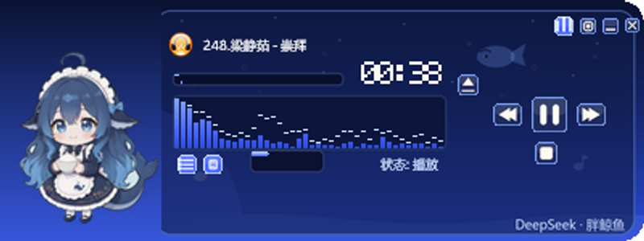

# NewTTplay

千千静听（TTPlayer）播放器 —— 深度定制皮肤与配套桌宠工程。



## 这是什么

以原版 **千千静听 TTPlayer**（2012）为基础，做了一套 **DeepSeek 鲸鱼主题** 的全套换肤工程，
外加一个自制的鲸鱼娘桌面宠物（`NTTWhale.exe`）和一个本地歌词服务器插件。

| 组件 | 说明 |
|---|---|
| `TTPlayer.exe` | 播放器主程序（原版，未修改） |
| `Skin/DeepSeekWhale.skn` | **主皮肤包**，深蓝 + 鲸鱼主题，含主窗/歌词窗/均衡器/播放列表四个窗口的美术 |
| `Skin/DeepSeekWhale-var*.skn` | 播放列表右上角 logo 的四个配色变体（渐变蓝 / 扁平 / 辉光 / 剪影） |
| `AddIn/NTTWhale.exe` | 鲸鱼娘桌面宠物，18 种状态动画（待机/摇尾/游泳/K歌/睡觉/投喂…） |
| `AddIn/lyrics-server/` | 本地歌词服务器 + `ttp_lrcsh` 插件源码（Node.js + C） |
| `jingyu-niang-assets/` | 鲸鱼娘美术**源素材**：19 组动画循环的 PNG 帧序列 + GIF 预览 + 品牌 SVG |
| `jingyu-niang-design_assets/` | 设计过程中的成品帧（含 8 帧舞蹈序列） |
| `jingyu-niang-design.miora` | miora 设计工程文件 |
| `images/deepseek/` | 参考图与效果截图 |
## 皮肤结构

`.skn` 本质是 **ZIP 包**，内含：

```
Skin.xml          # 窗口布局（position / resize_rect / 图片资源映射）
Lyric.xml         # 歌词窗配色
Playlist.xml      # 播放列表配色
Visual.xml        # 频谱分析配色
*.bmp             # 24bit 位图资源（主窗口 400x150、播放列表 313x200…）
```

### 九宫格拉伸规则（改皮肤必读）

播放列表位图只有 **313×200**，实际窗口是 **400×370**，
`Skin.xml` 里 `resize_rect="64, 52, 305, 188"` 定义了九宫格：

```
x < 64            固定
x 64..305        横向拉伸  →  系数 (400-64-8)/(305-64) = 1.361
x > 305          固定
y < 52           固定 1:1
y 52..188        纵向拉伸
```

**两个坑**：

1. 画在 `x 64..305` 的美术会被**横向拉宽 1.36 倍** —— 想保持圆形/正方比例，
   必须先按 `宽/1.361` 画进位图，引擎拉回来后才是对的。
2. `y > 54` 的区域会被列表底色 `Color_Bkgnd` **不透明覆盖**，
   画在那里的美术根本看不见。所以所有装饰必须收在 `y < 52` 的标题栏内。

主窗口（`player_window`）没有 resize_rect，是 **400×150 1:1**。

### 当前主题配色

| 用途 | 色值 |
|---|---|
| 频谱 高 / 中 / 低 | `#7ea6ff` / `#4d6bfe` / `#2b4bd8` |
| 背景 | `#0e1a4a` |
| 文字 / 高亮 | `#cfe0ff` / `#ffffff` |
| DeepSeek logo | `#4468FE`（官方 SVG） |

## 本地歌词服务器

`AddIn/lyrics-server/` 下是自研的本地歌词插件：

- `server.js` — Node.js 实现的本地 HTTP 服务（默认 `127.0.0.1:89`）
- `ttp_lrcsh_new.c` / `ttp_lrcsh_new.def` — 千千静听侧插件的 C 源码
- `开发进度-交接文档.md` / `逆向报告-千千静听本地歌词服务器.md` — 逆向分析笔记

启动：`AddIn/lyrics-server/启动歌词服务器.cmd`
部署：`AddIn/lyrics-server/部署-替换插件.cmd`

## 目录约定

以下目录**仅保留在本地，不入库**（已在 `.gitignore`）：

| 路径 | 内容 | 原因 |
|---|---|---|
| `_backup/` | 皮肤与配置的历史备份 | 版本库已有完整快照 |
| `_reference/miora_中间产物/` | AI 出图废弃稿（63MB） | 可再生 |
| `_reference/第三方插件原始包_本地歌词服务器/` | 第三方插件原始下载 zip（12MB） | 与 `AddIn/` 内容重复 |
| `jingyu-niang-design_assets/gen2/` `gen3/` | 多轮 AI 出图试验稿（41MB） | 可再生 |
| `jingyu-niang-design_assets/dance_src/` | 舞蹈序列切片源帧（19MB） | 成品在 `dance_f*.png` |
| `.workbuddy/` `.workbuddy-ai/` `.skinwork/` | 工作会话产物 | 临时文件 |
| `Music.library` `PlayList/*.ttbl` | 播放列表与曲库 | 用户个人数据 |
| `AddIn/log/` `AddIn/lyrics-server/log/` | 运行日志 | 运行时产物 |

> **为什么 PNG 占大头**：`jingyu-niang-assets/frames/` 的 90 张动画帧共 104MB。
> 它们是带调色板的 8bit PNG，文件内部已用 deflate 压缩过，
> Git 再压缩几乎无效（1388KB → 1378KB，只省 0.7%），所以仓库体积 ≈ 素材体积。

## 工具链备注

本机 **没有 Pillow / ImageMagick / Inkscape / rsvg**，且 pip 无可用源，
所以皮肤构建工具是自写的纯 Python：

- `skintool.py` — 24bit BMP 读写（`#ff00ff` 抠透明）
- `pngio.py` — PNG 编解码（zlib 手写 chunk）
- SVG → PNG：Chrome headless 渲染
  ```bash
  chrome.exe --headless=new --disable-gpu --hide-scrollbars \
    --default-background-color=00000000 --window-size=W,H --screenshot=out.png page.html
  ```
  必须带 `--default-background-color=00000000` 才是透明底。

## 致谢

- **千千静听 TTPlayer** — 原版播放器（迅雷 / 酷我）
- **DeepSeek** — 官方 logo 与品牌视觉
